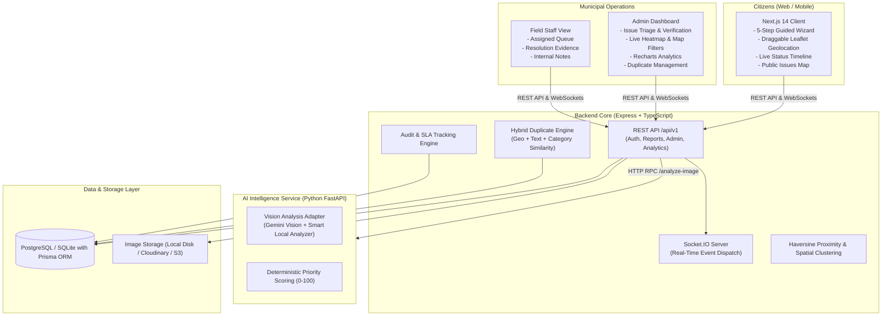

# CivicFix — AI-Powered Municipal Problem Reporting Platform


CivicFix is a modern, full-stack, enterprise-grade civic problem reporting and management platform. It enables citizens to photograph and report municipal infrastructure hazards (potholes, water leaks, broken streetlights, exposed wiring) while providing city administrators and field staff with an intelligent operations console for verification, priority scoring, duplicate detection, and live resolution tracking.

---

## 1. System Architecture



---

## 2. Technology Stack

- **Frontend**: Next.js 14 (App Router), React 18, TypeScript, Tailwind CSS, Leaflet + OpenStreetMap, Lucide Icons, Recharts, Socket.IO Client.
- **Backend**: Node.js, Express.js, TypeScript, Prisma ORM, PostgreSQL (with SQLite zero-dependency local fallback), JWT (Access + Refresh tokens), bcryptjs, Multer, Socket.IO, Swagger / OpenAPI 3.0.
- **AI Microservice**: Python 3.11, FastAPI, Pydantic v2, Uvicorn, Pillow, Google Gemini Vision SDK (`google-genai`), Pytest.
- **DevOps**: Docker, Docker Compose, Multi-stage Dockerfiles.

---

## 3. User Roles & Seed Demo Credentials

The platform provides role-based access control with pre-seeded accounts:

| Role | Email | Password | Primary Capabilities |
| :--- | :--- | :--- | :--- |
| **Administrator** | `admin@civicfix.org` | `Admin123!` | Full triage dashboard, verify/reject tickets, adjust priority, assign departments, merge duplicates, analytics & CSV export. |
| **Field Staff (Electrical)** | `worker.electrical@civicfix.org` | `Worker123!` | View assigned tickets, transition status to In Progress / Resolved, upload resolution notes and photo proof. |
| **Field Staff (Roads)** | `worker.roads@civicfix.org` | `Worker123!` | Road and asphalt repair queue management. |
| **Field Staff (Water)** | `worker.water@civicfix.org` | `Worker123!` | Water main and utility leaks triage. |
| **Citizen (Sarah)** | `citizen@civicfix.org` | `Citizen123!` | Submit issues, track ticket timelines, receive live alerts, confirm resolutions. |
| **Citizen (Alex)** | `alex@civicfix.org` | `Citizen123!` | Submit issues, track ticket timelines, comment. |

> **Tip:** The Login page features **One-Click Demo Role Switcher** buttons to test all roles immediately without typing credentials.

---

## 4. Key Functional Features

### 4.1 Citizen Experience
1. **Guided Multi-Step Reporting Wizard (`/report`)**:
   - **Step 1 — Upload Photo**: Mobile camera or file drag-and-drop (JPEG, PNG, WebP) with size and MIME validation.
   - **Step 2 — AI Analysis**: Vision model detects category, severity, confidence score, and generates a damage description draft. The citizen can inspect and override predictions before submission.
   - **Step 3 — Geolocation**: Browser GPS integration + interactive Leaflet map with a draggable pin and manual click selection.
   - **Step 4 — Additional Information**: Editable title, description, and landmarks.
   - **Step 5 — Duplicate Detection & Review**: Scans nearby reports in proximity. Shows similar tickets and lets citizens link or submit. Generates reference number `CF-YYYY-XXXXXX`.
2. **My Reports Portal (`/my-reports`)**:
   - Filter and search tickets by status, category, date.
   - Chronological lifecycle timeline modal.
   - Resolution verification: Citizen can mark "Confirm Resolved" or "Problem Persists (Reopen)".
3. **Public Map (`/map`)**:
   - Category-colored pin markers, clustering, and popup summaries.
   - Toggle between interactive map and accessible list view.

### 4.2 Administrator & Field Staff Operations
1. **Overview Dashboard (`/admin`)**: Real-time KPI metrics (Total issues, awaiting verification, in progress, resolved, critical count, SLA breaches, average resolution hours, resolution rate).
2. **Report Management (`/admin/reports`)**: Sortable, searchable table with inline triage actions:
   - Verify report or Reject with mandatory audit reason.
   - Assign to municipal department and staff member.
   - Re-score priority (0–100).
   - Merge duplicate tickets while preserving canonical tracking.
   - Add internal notes and resolution proof.
3. **Spatial Density Heatmap (`/admin/map`)**: Toggle between individual pins and density heatmaps to identify recurring infrastructure hotspots.
4. **Analytics & SLA (`/admin/analytics`)**: Recharts graphs (Trends over time, Category distribution, Severity breakdown, Department workload, SLA compliance) and CSV export download.

---

## 5. Report Lifecycle State Machine

```
[ REPORTED ] ──(Admin Verify)──> [ VERIFIED ] ──(Assign)──> [ ASSIGNED ]
     │                                │                           │
     ├──(Admin Reject)─> [ REJECTED ] ├──(Admin Reject)           │
     │                                │                           ▼
     └──(Merge)───────> [ DUPLICATE ] └──(Start Work)────> [ IN PROGRESS ]
                                                                  │
                                                                  ▼
[ IN PROGRESS ] <──(Citizen Reopens)─────── [ RESOLVED ] <──(Complete Work)
```

Every transition updates the database inside a transaction, creates an immutable `ReportStatusHistory` audit entry, dispatches in-app notifications, and broadcasts typed WebSocket events via Socket.IO.

---

## 6. AI Vision & Priority Scoring Engine

### 6.1 Vision Engine
- **Configurable Adapters**:
  - `GeminiVisionProvider`: Integrates with Google Gemini Vision API (`gemini-2.5-flash`) via `google-genai` SDK.
  - `LocalVisionProvider`: Smart offline heuristic vision analyzer verifying image validity, luminance, texture variance, and problem heuristics for 100% offline local development without external credentials.
- **Categories Identified**: Pothole, Broken Streetlight, Garbage Accumulation, Water Leakage, Blocked Drainage, Damaged Sidewalk, Fallen Tree, Exposed Electrical Wiring, Damaged Infrastructure, Other.

### 6.2 Priority Scoring Formula
$$
\text{Priority Score} = w_{\text{sev}} \cdot S + w_{\text{safe}} \cdot R + w_{\text{corrob}} \cdot C + w_{\text{infra}} \cdot I + w_{\text{age}} \cdot A
$$
Where:
- $S$ (Severity): Low (20), Medium (50), High (80), Critical (100) [Weight: 35%]
- $R$ (Safety Hazard Level): Low (15), Medium (45), High (80), Critical (100) [Weight: 30%]
- $C$ (Corroborating Reports): Scaled up to 5 nearby duplicates [Weight: 15%]
- $I$ (Critical Infrastructure): Nearby hospital, school, power grid [Weight: 10%]
- $A$ (Report Age): Escalation up to 72 hours [Weight: 10%]

Score mapped to levels:
- **0–24**: LOW
- **25–49**: MEDIUM
- **50–74**: HIGH
- **75–100**: CRITICAL

---

## 7. Quick Start & Local Execution

### Prerequisites
- Node.js (v18+)
- Python (v3.10+)

### Step 1: Start the AI Service
```powershell
cd ai-service
python -m venv .venv
.venv\Scripts\activate
pip install -r requirements.txt
uvicorn main:app --host 0.0.0.0 --port 8000 --reload
```
*Health check:* `http://localhost:8000/health`

### Step 2: Start the Backend
```powershell
cd backend
npm install
npm run prisma:generate:sqlite
npm run prisma:push:sqlite
npm run db:seed
npm run dev
```
*API & OpenAPI Swagger Docs:* `http://localhost:5000/api/docs`

### Step 3: Start the Frontend
```powershell
cd frontend
npm install
npm run dev
```
*Web Application:* `http://localhost:3000`

---

## 8. Docker Deployment

To launch the complete containerized stack (PostgreSQL 16, Backend, AI Service, and Frontend) with a single command:

```bash
docker-compose up --build -d
```

- Web Client: `http://localhost:3000`
- REST API: `http://localhost:5000/api/v1`
- Swagger UI: `http://localhost:5000/api/docs`
- AI Microservice: `http://localhost:8000/docs`
- PostgreSQL: `localhost:5432`

---

## 9. Running Automated Tests

### Backend Test Suite (Jest & Supertest)
```powershell
cd backend
npm test
```
*Runs 14 automated integration tests covering authentication, RBAC authorization, report lifecycle rules, duplicate detection, and analytics.*

### AI Service Test Suite (Pytest)
```powershell
cd ai-service
.venv\Scripts\pytest -v
```
*Runs tests for image analysis validation, MIME checking, priority score calculations, and health probes.*

---

## 10. License

CivicFix is distributed under the MIT Open Source License.
"# civic-fix" 
